# UNIDAD 3 — PRÁCTICA 1

---

## Ejercicio 1. Manipulación de arrays

### 1.1. Crear el array de datos

<div style="margin-left: 30px;">

Se crea un array de objetos que contiene el nombre, teléfono y edad de cada persona. También se define una función para mostrar los datos en una tabla HTML.

```js
let data = [
    {name: "Nacho", telephone: "966112233", age: 40},
    {name: "Ana", telephone: "911223344", age: 35},
    {name: "Mario", telephone: "611998877", age: 15},
    {name: "Laura", telephone: "633663366", age: 17}
];

function imprimirArray(arrayDatos, idHtml, enunciado) {
    textoHtml = "";
    textoHtml = textoHtml + "<h2>" + enunciado + "</h2>";
    textoHtml = textoHtml +
        "<table>" +
            "<thead>" +
                "<th>Nombre</th> <th>Telefono</th> <th>Edad</th>" +
            "</thead> <tbody>"
    ;

    for (let i = 0; i < arrayDatos.length; i++) {
        textoHtml = textoHtml + "<tr>" +
            "<td>" + arrayDatos[i].name + "</td>" +
            "<td>" + arrayDatos[i].telephone + "</td>" +
            "<td>" + arrayDatos[i].age + "</td>" +
        "</tr>";
    }

    textoHtml = textoHtml + "</tbody></table>";
    document.getElementById(idHtml).innerHTML = textoHtml;
}
```

</div>

### 1.2. Añadir dos elementos al final del array

<div style="margin-left: 30px;">

Se crea una función que recibe el nombre, el teléfono y la edad de una persona. Después, genera un nuevo objeto y lo añade al final del array mediante `push()`.

```js
function añadirElemento(nom, tlf, edad) {
    let nuevaPersona = {
        name: nom,
        telephone: tlf,
        age: edad
    };

    data.push(nuevaPersona);
}
```

**Resultado:**

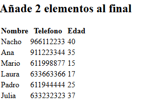

</div>

### 1.3. Comprobar que se han añadido los elementos

<div style="margin-left: 30px;">

Se utiliza `console.log()` para mostrar el array por consola y comprobar que los nuevos elementos se han añadido correctamente.

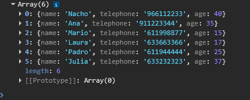

</div>

### 1.4. Ordenar el vector por edad

<div style="margin-left: 30px;">

Se utiliza el método `sort()` para ordenar los elementos por edad, de mayor a menor.

```js
data.sort((a, b) => b.age - a.age);
```

**Resultado:**

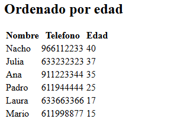

</div>

### 1.5. Ordenar el vector por nombre

<div style="margin-left: 30px;">

Se utiliza `sort()` junto con `localeCompare()` para ordenar alfabéticamente los elementos según el nombre de cada persona.

```js
data.sort((a, b) => a.name.localeCompare(b.name));
```

**Resultado:**

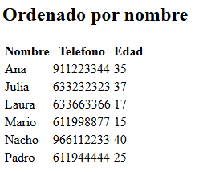

</div>

### 1.6. Crear y mostrar un nuevo vector con los mayores de 30 años

<div style="margin-left: 30px;">

Se crea la función `mayores30()`, que recorre el array original y añade a un nuevo vector únicamente las personas cuya edad sea superior a 30 años. Finalmente, devuelve el nuevo vector.

```js
function mayores30(arrayBase) {
    let edad30 = [];

    for (let i = 0; i < arrayBase.length; i++) {
        if (arrayBase[i].age > 30) {
            edad30.push(arrayBase[i]);
        }
    }

    return edad30;
}
```

**Resultado:**

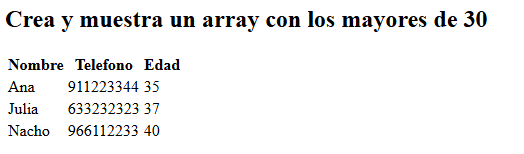

</div>

---


## Ejercicio 2. 
### Crea un array llamado valores que contenga números, algunos de los cuales son duplicados. Utiliza un Set para crear un nuevo array que contenga solo los números únicos y luego imprímelo.

<div style="margin-left: 30px;">
    Creamos un array el cual contenga los valores que hemos decidido poner. Una vez hecho esto agregamos una función la cual cogera este array y retornará un array sin duplicados ya que la pasará por un set creando un nuevo array sin duplicados. <br> <br>
    Una vez tenemos el array lo pasaremos por la función de impresión de array en tabla

```js
let valores =  [ 10, 20, 30, 40, 20, 50, 60, 70, 10, 30, 50, 80, 100, 100, 90];

function sinDuplicados (vDuplicados){
    let vUnicos = Array.from(new Set (vDuplicados));
    return vUnicos;
}

function imprimirHtml (array, idHtml, titulo){
    let textoHtml = "";
    textoHtml = textoHtml + 
        " <p> <table border = '1' cellspacing='0' style='border-color: black'>" + 
            "<thead> " +
                "<tr> <th colspan = " + array.length + ">" + titulo +"</th> </tr>" +
            "</thead>" +
            "<tbody> <tr>";
            
    for (let i = 0; i < array.length; i ++){
        textoHtml = textoHtml + "<td>" + array[i] + "</td>";
    }

    textoHtml = textoHtml + "</tr> </tbody> </table> </p>";
    document.getElementById(idHtml).innerHTML = textoHtml;
}

imprimirHtml(valores, "arrayOriginal", "Array original")
imprimirHtml(sinDuplicados(valores), "arrayMod", "Array sin Duplicados");
```

**Resultado:** 
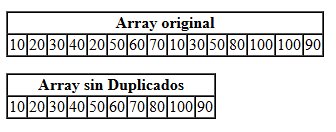

</div>

---


## Ejercicio 3. 
### 3.1 - Crea un Map que almacene nombres como claves y edades como valores.
<div style="margin-left: 30px;">

```js
let edadPersonas = new Map ([["Dani", 21]]);
```
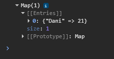

</div>


### 3.2 - Agrega algunos nombres y edades.
<div style="margin-left: 30px;">

```js
edadPersonas.set("Diego", 18);
edadPersonas.set("Narcis", 20);
edadPersonas.set("Xavi", 27);
```
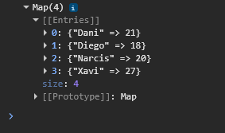

</div>

### 3.3 - Actualiza la edad de uno de ellos.

<div style="margin-left: 30px;">

```js
if (edadPersonas.has(nom)){
    edadPersonas.set(nom, 19);
    console.log("La edad de " + nom + "ha sido actualizada.");
} else {console.log("No se ha encontrado a " + nom + " en el mapa.");}
```
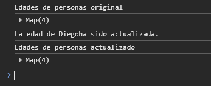

</div>

### 3.4 - Imprime todos los nombres con sus edades.

<div style="margin-left: 30px;">

```js
function imprimeMapa(mapa, titulo, idHtml){
    let edades = Array.from(mapa.entries());
    let textoHtml = "";
    textoHtml = textoHtml + 
        " <p> <table border = '1' cellspacing='0' style='border-color: black'>" + 
            "<thead> " +
                "<tr> <th colspan = " + edades.length + ">" + titulo +"</th> </tr>" +
            "</thead>" +
            "<tbody> <tr>";
      
    
    for (let i = 0; i < edades.length; i ++){
        let nom = edades[i][0];
        let edad = edades[i][1];

        textoHtml = textoHtml + "<tr><td>" + nom + "</td>" + "<td>" + edad + "</td></tr>";
    }

    textoHtml = textoHtml + "</tbody> </table> </p>";
    document.getElementById(idHtml).innerHTML = textoHtml;
}

imprimeMapa (edadPersonas, "Edad de las personas", "mapa");
```
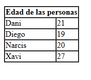

</div>

---


## Ejercicio 4.
### Mostrar por consola 50 combinaciones aleatorias de la loteria. Las combinaciones son 6 numeros del 1 al 49, pero debe tenerse en cuenta que no se deben de repetir los numeros en una misma combinación.

<div style="margin-left: 30px;">

```js
let lot= [];

function rellenarLoteria (array){
    for (let i = 0; i < 50; i++){
        let combinacion = [];
        while (combinacion.length < 6){
            let numero = Math.floor(Math.random()*49)+1;
            if(!combinacion.includes(numero)){
                combinacion.push(numero);
            }
        }
        array.push(combinacion);
    }
    return array;
}

lot = rellenarLoteria(lot);
```
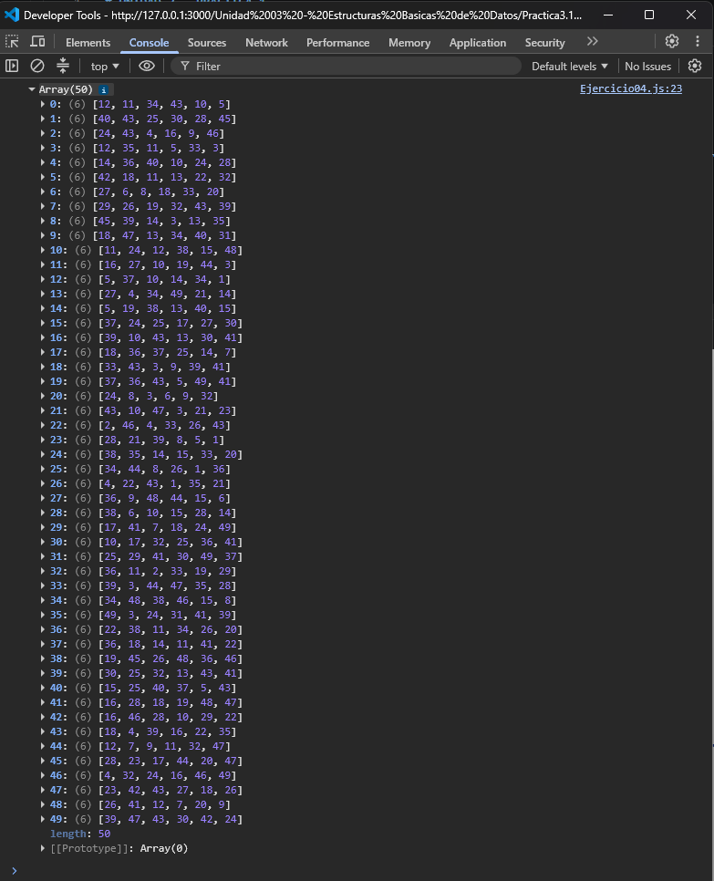
</div>

---

